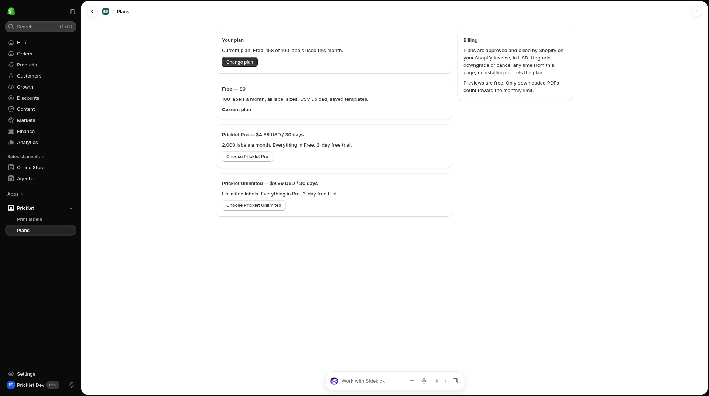
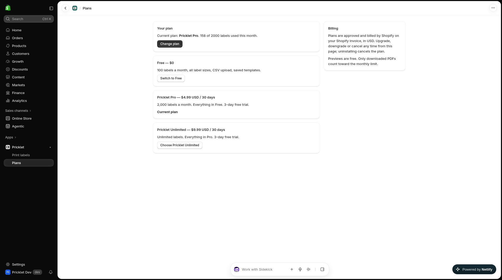
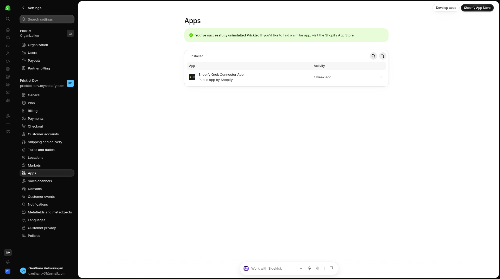

# Pricklet: Barcode Labels — proof of fix for review 152708 (1.2.2)

Fix deployed 21 Nov 2026 (build 5170f14). Tested end to end on development store `pricklet-dev`.

**Root cause:** after a reinstall, an in-app navigation could reach `/app/plans` before App Bridge attached a session token; the library's auth handshake response (status 200) was not recognised by our error boundary in the minified production build, so React Router showed "Unhandled Thrown Response! 200" and "See plans" appeared to do nothing.

**Fix:** the app is on Shopify App Pricing, so the Plans page now reads the current plan from `currentAppInstallation.activeSubscriptions` on every load and every plan button opens Shopify's hosted plan selection page (top frame). Accept, decline and re-approval after reinstall are handled by Shopify. Token-less data requests now get a 401 retry so App Bridge retries with a fresh token, stale tokens are re-authenticated, error boundaries work in production, and uninstall resets the plan to Free. No Billing API calls remain.

## Test run (install → upgrade → decline → downgrade → uninstall → reinstall → upgrade)

1. Plans page via sidebar navigation (no error, plan picker shown) 
2. Plans page after a full reload 
3. "Choose Pro" opens Shopify's plan selection page 
4. Pro approved, app shows Pro 
5. Unlimited approval screen (then declined with Cancel) 
6. After declining, app still on Pro 
7. Downgrade to Free 
8. App uninstalled (while on Unlimited) 
9. Reinstalled: app opens normally 
10. After reinstall: Plans via nav and reload, no error, plan picker shown 
11. After reinstall: upgrade to Pro re-approved through Shopify, app shows Pro 

Monthly label usage is tracked per shop and intentionally survives reinstall (it resets each calendar month).
