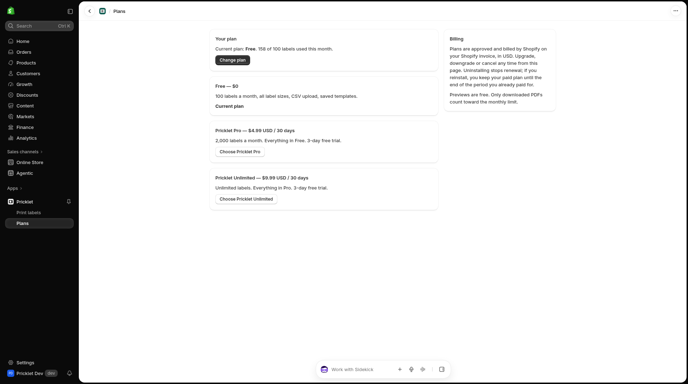
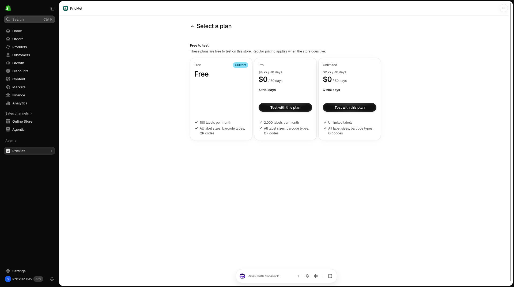
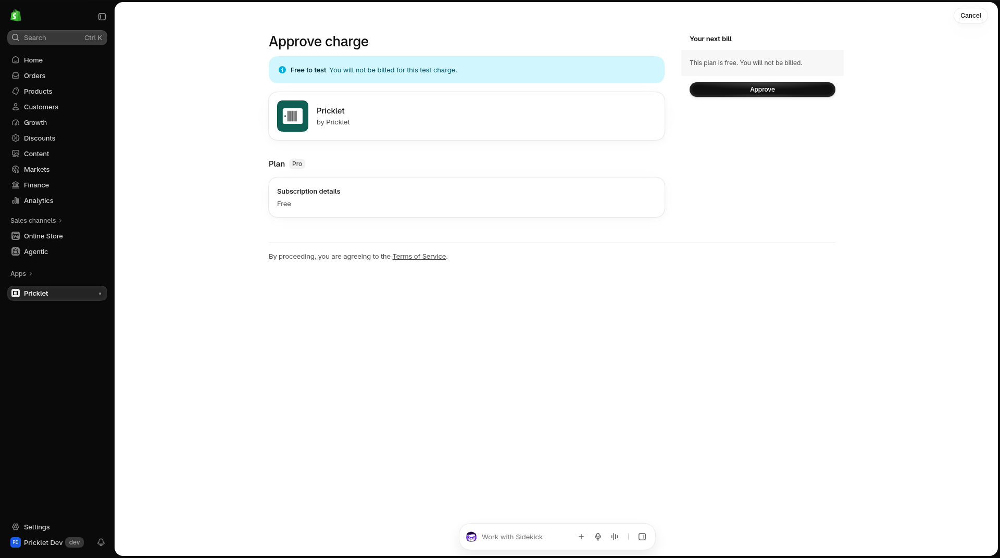
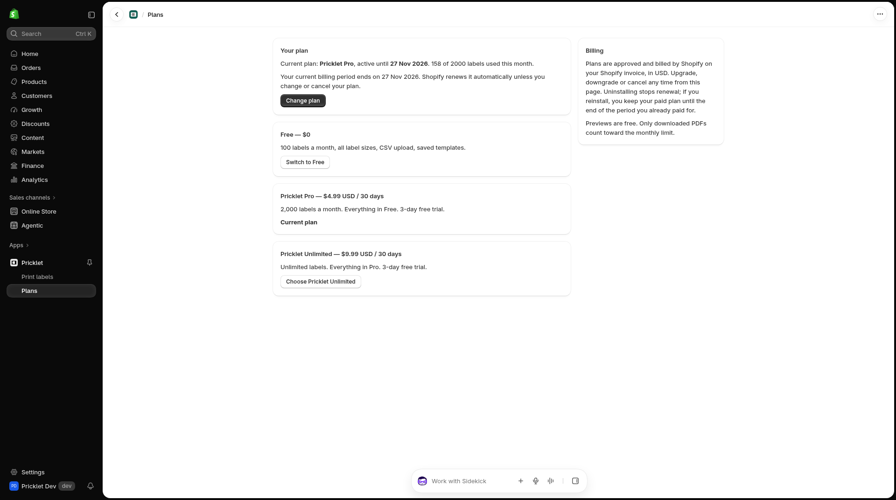
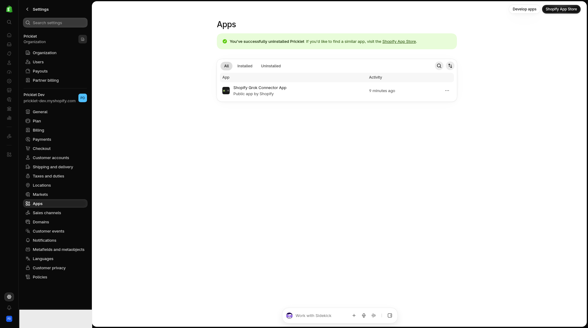
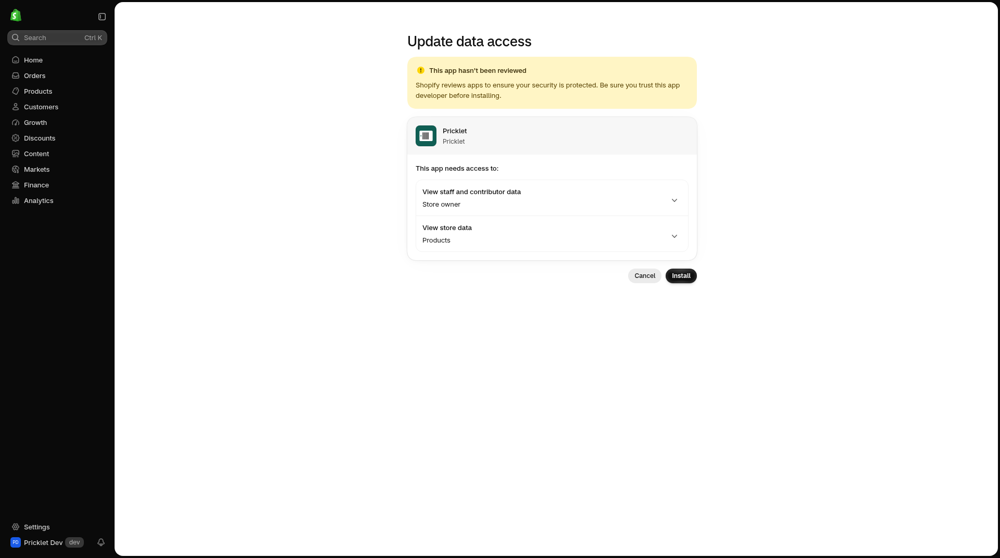
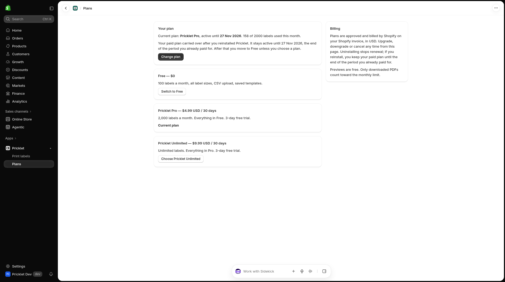
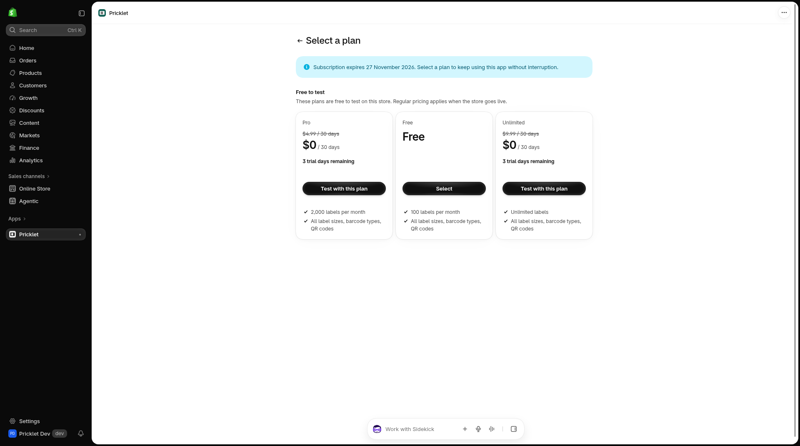
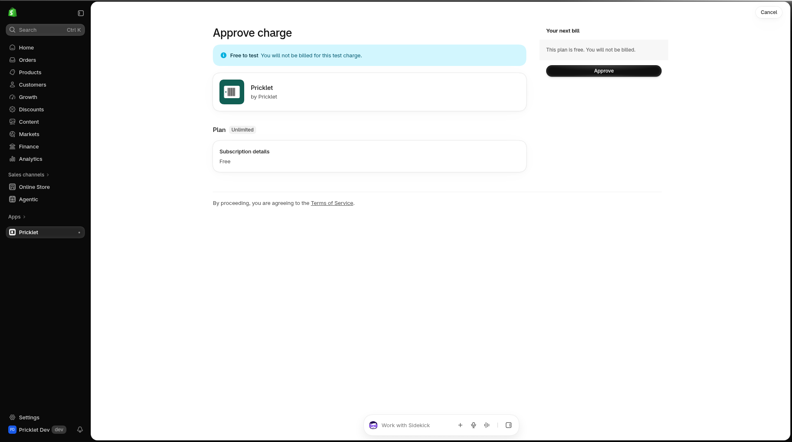
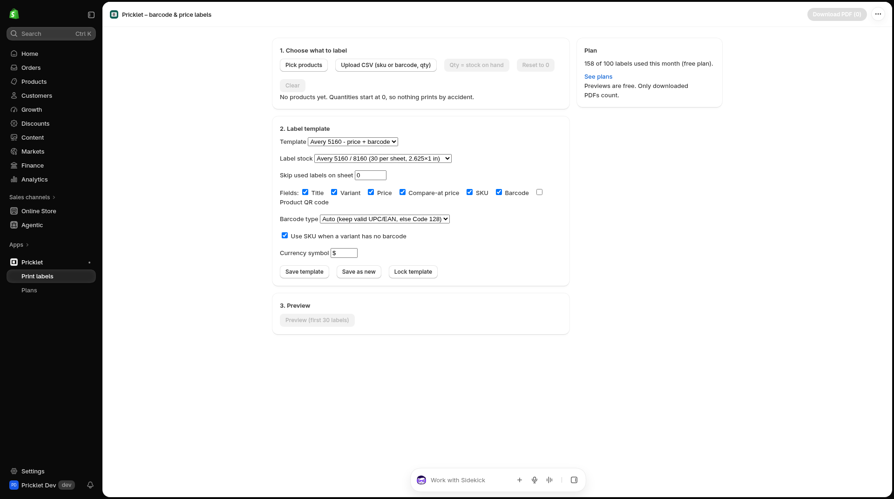

# Pricklet: Barcode Labels — proof of fix for review 152708

## Fix for: paid subscription reverting to Free after reinstall (ref 152708, 25 Nov 2026)

Fix deployed 25 Nov 2026 (build a12b87a). Tested end to end on development store `pricklet-dev` on 25 Nov 2026.

### Root cause, in plain words
When a merchant uninstalled Pricklet, our uninstall handler reset their plan to Free. Shopify cancels the subscription on uninstall, but the merchant has already paid for the rest of the billing period. After the reinstall, Shopify's Admin API no longer lists that cancelled subscription as active for the new installation. Its `currentPeriodEnd` is also no longer returned once it is not active. So the app had nothing telling it the paid time was still running, and it showed Free.

### What changed
- While a paid subscription is **ACTIVE**, the app saves its end date (`AppSubscription.currentPeriodEnd`) with the plan.
- **Uninstall no longer resets the plan.** It only removes access tokens and records when the uninstall happened.
- **On every app open, including right after a reinstall,** the app queries Shopify for `currentAppInstallation.activeSubscriptions` and `allSubscriptions`, and checks the `charge_id` Shopify returns after a plan approval. It then decides:
  - If a subscription is active, that plan applies.
  - If the app was reinstalled (detected by the uninstall webhook or by a new app installation id) and the paid period has not ended, the paid plan stays in force until that date.
  - If Shopify still lists the paid subscription that the uninstall cancelled, it is used too.
- The Plans page shows the plan **and the date it stays active until**. Label limits follow the same plan, so Pro keeps 2,000 labels a month.
- When the paid period ends, the app moves to Free. A merchant who downgrades while the app is installed goes to Free straight away.
- No Billing API create calls are used. Plans are chosen on Shopify's hosted plan page (Shopify App Pricing).

### Test run (Free → approve Pro → uninstall → reinstall → still Pro until the period ends)

1. Before: Plans shows **"Current plan: Free. 158 of 100 labels used this month."**
   
2. "Change plan" opens Shopify's hosted plan selection page. Pro is chosen.
   
3. Shopify's "Approve charge" screen for Pro (free to test on a development store). Approved.
   
4. Back in the app, Plans shows **"Current plan: Pricklet Pro, active until 27 Nov 2026. 158 of 2000 labels used this month."**
   
5. Print labels shows the Pro allowance: **"158 of 2000 labels used this month (pro plan)"**.
   
6. Pricklet uninstalled from Settings > Apps while on Pro.
   
7. Pricklet reinstalled.
   
8. After reinstall, Plans still shows **"Current plan: Pricklet Pro, active until 27 Nov 2026. 158 of 2000 labels used this month."** It also shows **"Your paid plan carried over after you reinstalled Pricklet. It stays active until 27 Nov 2026, the end of the period you already paid for. After that you move to Free unless you choose a plan."**
   
9. Shopify's own hosted plan page after the reinstall confirms the same date: **"Subscription expires 27 November 2026."** The app's date matches Shopify's.
   

Monthly label usage is tracked per shop and survives reinstall on purpose (it resets each calendar month), which is why usage stays at 158.

---

## Previous fix: Plans page crash after reinstall (21 Nov 2026, build 5170f14)

This was the earlier round of review 152708. Fix deployed 21 Nov 2026 (build 5170f14). Tested end to end on development store `pricklet-dev`.

**Root cause:** after a reinstall, an in-app navigation could reach `/app/plans` before App Bridge attached a session token; the library's auth handshake response (status 200) was not recognised by our error boundary in the minified production build, so React Router showed "Unhandled Thrown Response! 200" and "See plans" appeared to do nothing.

**Fix:** the app is on Shopify App Pricing, so the Plans page now reads the current plan from `currentAppInstallation.activeSubscriptions` on every load and every plan button opens Shopify's hosted plan selection page (top frame). Accept, decline and re-approval after reinstall are handled by Shopify. Token-less data requests now get a 401 retry so App Bridge retries with a fresh token, stale tokens are re-authenticated, error boundaries work in production. (Superseded on 25 Nov: uninstall no longer resets the plan; see above.) No Billing API calls remain.

### Test run (install → upgrade → decline → downgrade → uninstall → reinstall → upgrade)

1. Plans page via sidebar navigation (no error, plan picker shown) 
2. Plans page after a full reload 
3. "Choose Pro" opens Shopify's plan selection page 
4. Pro approved, app shows Pro 
5. Unlimited approval screen (then declined with Cancel) 
6. After declining, app still on Pro 
7. Downgrade to Free 
8. App uninstalled (while on Unlimited) 
9. Reinstalled: app opens normally 
10. After reinstall: Plans via nav and reload, no error, plan picker shown 
11. After reinstall: upgrade to Pro re-approved through Shopify, app shows Pro 

Monthly label usage is tracked per shop and intentionally survives reinstall (it resets each calendar month).
